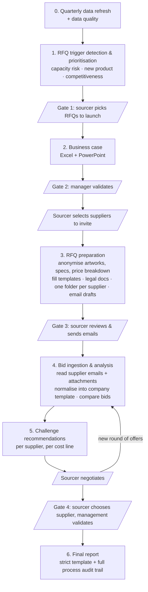
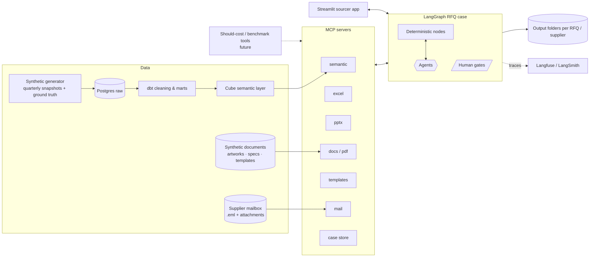

# Sourcing-Pilot-PPD

> An agentic pipeline that runs a **packaging sourcer's full RFQ workflow**: it detects which RFQs matter most, builds the business case, prepares every RFQ document, analyses supplier bids, suggests how to challenge suppliers, and writes the final report. **The sourcer keeps the decisions and the negotiation.**

**Status:** planning / MVP design
**Goal of the MVP:** an end-to-end demo for my former manager in direct sourcing, built entirely on synthetic packaging data, that shows how much sourcer time goes into admin work and how much of it can be automated.

---

## 1. The problem

In direct sourcing there are always **more RFQs and optimisations to run than sourcers have time for**. The bottleneck isn't negotiation (where the sourcer creates real value). It's all the admin around it:

| Step | What happens today | Why it hurts |
|---|---|---|
| Data gathering | Pull volumes, capacities, prices, contracts and supplier data from several systems, with new data every quarter | Manual, repetitive, error-prone (units, name variants, typos, missing values) |
| Opportunity analysis | Excel analyses to decide which RFQs are worth launching | Rebuilt every quarter; stale after ~3 months |
| Business case | Copy numbers into PowerPoint for the manager to validate | Copy-paste between Excel and PPT, version and merge conflicts |
| RFQ preparation | Anonymise artworks, specs and price breakdowns; fill templates; attach legal docs; build one folder per supplier | Pure admin, but it has to be exact. One leaked brand name is a real problem |
| Bid analysis | Normalise supplier offers (each formats them differently) into the company's analysis template | Slow, repeated after every negotiation round |
| Final report | Document the whole process and the decision in a strict template | Re-assembling everything at the end |

**The insight:** the process is **the same every time and every quarter**, so it's a good candidate for automation. It **can't be fully deterministic**, though: data is entered by people, templates vary, and suppliers answer in their own formats. So the target architecture is:

> **A deterministic pipeline, with LLM agents called only at the strategic points where judgement or fuzziness is needed, and the sourcer approving at each decision gate.**

---

## 2. Key design decisions

1. **Synthetic data with planted ground truth.** The generator deliberately plants RFQ triggers (saturated lines, overpriced components, contracts due for review, new launches), **decoys** (things that look like opportunities but aren't) and **data errors**. Because we know exactly what the pipeline *should* find, evals become measurable ("found 9 of 10 planted RFQs, rejected all decoys") instead of "looks good".
2. **The LLM never does the maths.** Saturation rates, price gaps, savings, TCO and bid comparisons are plain, unit-tested Python/SQL. Agents only do what code can't: interpret messy data, map varying templates and supplier formats, detect sensitive content, and write the narrative and challenge arguments.
3. **Agents call high-level tools, not cell-by-cell edits.** We expose tools such as `fill_template(template_id, data)` and `query_metric(metric, dims, filters)` instead of letting an LLM drive Excel/PowerPoint cell by cell. That's more reliable, cheaper, easy to evaluate, and essential for swapping in small fine-tuned open models later.
4. **Structured outputs everywhere.** Each agent returns a validated Pydantic schema. On failure: retry, then escalate to the sourcer.
5. **Every number is traceable.** Each figure in a deck, Excel file or report carries its data lineage, so artefacts can be regenerated when new quarterly data arrives.
6. **Quarterly re-run is a first-class use case.** Run on Q1, then Q2: every artefact is regenerated, with *what changed* highlighted. That tackles the "stale after 3 months" problem head on.
7. **Long-running RFQ cases with human gates.** An RFQ lasts weeks. Each RFQ is a persisted *case* (LangGraph with a Postgres checkpointer) that pauses at gates (`interrupt`) and resumes when the sourcer acts.
8. **The MVP doesn't make the sourcer's decisions.** It doesn't propose suppliers, doesn't send emails on its own, doesn't negotiate and doesn't award. It prepares, analyses and recommends.
9. **Log everything from day one** (Langfuse/LangSmith). Agent traces become the training data for phase 2 (open-weight, task-specific models), compared on the same evals.
10. **No real L'Oréal data, templates, supplier names or documents.** Everything is recreated generically, so the demo can be shared without NDA risk.
11. **Assumptions are explicit.** Operational data is rarely "correct" (ongoing negotiations, last quarter's figures, manual Excel errors). So every output carries an **assumptions & data-cleaning log**: which values were corrected, excluded or estimated, and why. The sourcer validates the assumptions, not just the result.
12. **External tools behind adapters.** Benchmarking and should-cost tools will sit behind an adapter interface plus MCP server. They're **not in the MVP** (see §8), but the interface is designed from the start so they can be plugged in without rework.

---

## 3. The sourcer workflow covered by the MVP



| # | Stage | Automated by the MVP | Done by the sourcer |
|---|---|---|---|
| 0 | Data refresh | Ingest quarterly data, clean it, reconcile, report on data quality | Approve ambiguous fixes |
| 1 | Trigger detection | Detect and **rank** RFQ candidates across the 3 triggers | Choose which to launch |
| 2 | Business case | Excel analysis + PowerPoint deck for the manager | Present and get validation |
| 3 | RFQ preparation | Anonymise all documents, fill templates, add legal docs, build one folder per supplier, draft emails | **Select suppliers**, review, send |
| 4 | Bid ingestion & analysis | Read supplier emails and attachments (our templates or their own), extract and normalise each offer, flag gaps, fill the deterministic company analysis template, compare | Confirm low-confidence values |
| 5 | Challenge | Per-supplier challenge points and arguments | **Negotiate** (where the value is created) |
| 6 | Award & report | Award scenario summary, final report in the strict template | **Choose supplier**, get sign-off |

### 3.1 Stage 1: RFQ triggers and prioritisation

There are three reasons to launch an RFQ, all detected automatically. **Capacity saturation is the MVP priority.**

| Trigger | MVP priority | Logic (deterministic) | Data used |
|---|---|---|---|
| **A. Supply risk / capacity saturation** | **1, core of the MVP** | See *Saturation model* below | forecasts, line capacities, CM capacities |
| **B. New product (NPD)** | 2 | New SKU in the launch pipeline whose BOM contains components without an existing contract/supplier, or whose extra volume pushes saturation up | launch pipeline, BOMs, contracts |
| **C. Competitiveness review** | 3 | Contract ≥ 3 years since the last RFQ. *(The price-vs-should-cost check is a future improvement, see §8)* | contracts, RFQ history |

#### Saturation model (capacity check)

**Scope:** each **hero / business-driver finished product (PF)** and its **packaging components (AC)**, followed down to the **production lines** that make them. These are both the company's **own plant lines** and **suppliers' lines**, with **contract manufacturers (CMs)** as extra capacity. Horizon: **3 years**, by quarter.

Two volume scenarios and two capacity scenarios:

| | Definition |
|---|---|
| **QTY baseline** | Reference demand forecast |
| **QTY stretch** | High demand scenario (e.g. a product going viral) |
| **Baseline capacity** | Capacity of the lines in use today (own plant + current suppliers), **without** CMs |
| **Stretch capacity** | Baseline capacity **plus** CM capacity available today but not yet used |
| **Baseline saturation** | QTY baseline ÷ baseline capacity |
| **Stretch saturation** | QTY stretch ÷ stretch capacity |

The engine also computes the cross-cases (baseline demand on stretch capacity, stretch demand on baseline capacity) so the business case can show the full matrix.

| Situation | Interpretation | Severity |
|---|---|---|
| Baseline OK, stretch OK | No capacity issue | none |
| Baseline > threshold, stretch OK | Activating CMs absorbs it short-term, but there's no buffer → consider an RFQ / investment | medium |
| Stretch > threshold | **Even with every available CM activated, the high scenario can't be produced** → RFQ for new capacity or investment | **high** |
| Projected to cross a threshold within N quarters | Early warning; urgency depends on lead time (RFQ, qualification, new mould/tooling) | depends on time to breach |

Thresholds (e.g. 85% / 100%) and the horizon are configurable.

**Output: a recommendation per bottleneck**, with the trade-off the manager has to decide on:
- **Invest** in a new mould/tooling or line (own plant or supplier)
- **Subcontract**: activate or extend CM capacity
- **RFQ** to qualify a new or second supplier

Each option shows its cost, capacity gained, lead time and fit with the **annual investment budget cap**. If the cap is exceeded, a short-term workaround is proposed until the investment can be made.

**Prioritisation score (MVP):** severity (baseline vs stretch, how far above threshold), **time to breach** compared with the lead time of the fix, volume and revenue at risk (hero products weigh more), and sole-source exposure. NPD and 3-year-review candidates are ranked in the same list with their own weights.

The analyst agent then explains each candidate in plain language, sanity-checks it (e.g. a one-quarter forecast spike vs a structural trend, a capacity figure in the wrong unit, a CM not qualified for the component) and flags any data it doubts.

### 3.2 Stage 2: Business case
Deterministic calculations (saturation matrix per hero product, invest vs subcontract vs RFQ options with cost and lead time, investment budget impact, volume at risk, and later savings scenarios) rendered into an **Excel analysis** and a **PowerPoint deck** from templates. A storyline agent writes the executive summary and slide titles. Every number in the deck is checked against the source.

### 3.3 Stage 3: RFQ preparation
Once the sourcer has selected the suppliers to invite:
- **Anonymisation** of artworks (PDF/images: brand names, logos, product names, barcodes), product/component specifications and price-breakdown templates (volumes, current price, incumbent). The pipeline is rules/NER, then an LLM/vision pass, then redaction, then an **OCR-based leak check** on the output (zero-tolerance gate).
- **Templates**: RFQ letter, price-breakdown (cost model) template, volume/lot sheet, timeline.
- **Legal docs**: NDA, general purchasing conditions, quality agreement and other standard documents (mostly sent as templates).
- **One folder per supplier**, named and structured consistently, plus a checklist of what's inside.
- **Email drafts** per supplier for the sourcer to send.

### 3.4 Stage 4: Bid ingestion & analysis
This is **one of the main places LLMs add value**, because supplier answers are highly non-deterministic:
- Suppliers reply **by email**: sometimes with our templates filled in (fully, partly or altered), sometimes with **their own documents** (Excel, PDF, Word), and sometimes with key information (price, MOQ, lead time, conditions) only in the **email body**.
- An **ingestion pipeline** reads the mailbox (an `.eml`/`.msg` export folder in the MVP), matches each email to the RFQ case and supplier, and extracts the attachments.
- An **extraction agent** maps everything (body plus attachments) into a **normalised bid schema** (Pydantic). Each extracted value keeps a **source reference** (file, sheet/page, cell/paragraph), and the agent flags missing, ambiguous or contradictory information. Values with low confidence go to the sourcer for confirmation.
- A **completeness check** (deterministic) lists what's missing per supplier and can draft a follow-up email asking for it.
- The **deterministic company analysis template** is then filled in: price per cost line (raw material, conversion, decoration, tooling, packaging, transport, margin), TCO (Incoterms, MOQ, tooling amortisation, lead time), **capacity offered vs the capacity gap that triggered the RFQ**, comparison vs incumbent and other bidders, and non-price criteria: quality, lead time, **MOQ** (a well-set MOQ lowers unit price, a wrong one costs money), and **sustainability**, which weighs alongside price (recycled/recyclable materials, lightweighting, electrified production machines, proximity to the plant).
- Supports **several negotiation rounds**, with round-over-round evolution tracked.

### 3.5 Stage 5: Challenge recommendations
For each supplier: which cost lines and conditions are out of line **compared with the other bids and the incumbent** (price per cost line, MOQ, lead time, tooling, payment terms, capacity offered vs needed), by how much, suggested arguments and questions, and a target. Grounded only in the computed gaps, so the agent can't invent facts. *(Should-cost and benchmark comparisons are added later, see §8.)*

### 3.6 Stage 6: Final report
Generated in a **strict template**: context and trigger, business case, suppliers consulted, rounds and price evolution, analysis, decision and rationale, savings / risk reduction achieved, and a timeline of the process (audit trail drawn from the case history).

---

## 4. Architecture



### 4.1 Synthetic data (PostgreSQL), packaging domain

> **Implemented (v0):** the generator lives in [`data_gen/`](data_gen/README.md) and writes CSV/Excel exports plus a ground truth. The tables below are the target model; loading into PostgreSQL comes next.

**Component families:** plastic bottles (PET/HDPE/PP), glass bottles and jars, pumps and sprays, caps/closures, labels, tubes, folding cartons.

| Table | Content |
|---|---|
| `finished_products` | PF code, brand (fictional), launch date, status, **hero / business-driver flag** |
| `bom` | SKU → components and quantity per unit |
| `components` | code, family, technology, description, material, spec reference, UoM |
| `suppliers` | id, name (fictional), country, technologies, certifications, ESG score |
| `production_lines` | line id, **owner type (own plant / supplier)**, owner, technology (e.g. injection blow moulding, glass furnace, label press, pump assembly), **capacity per quarter**, status (in use) → **baseline capacity** |
| `contract_manufacturers` | CM id, technology, **available capacity**, capacity already used, qualified components → **stretch capacity** = available minus used |
| `line_allocation` | which components run on which lines/CMs, and the share of volume |
| `plants` | id, region, country |
| `forecasts` | quarterly demand per PF/component × plant over **3 years**, in two scenarios: **QTY baseline** and **QTY stretch** |
| `investments` | mould/tooling/line investment options: cost, capacity added, lead time; annual investment budget cap |
| `contracts` | supplier × component (PIR-like purchasing record): price, MOQ, lead time, currency, Incoterm, start/end, last RFQ date, standard valuation |
| `purchase_orders` | PO lines: date, plant, component, supplier, qty, UoM, unit price, currency |
| `price_breakdowns` | current cost breakdown per component × supplier |
| `npd_projects` | launch pipeline: new SKUs, launch dates, new components, volume ramp-up |
| `supplier_performance` | OTIF, quality incidents, lead time per quarter |
| `rfq_cases`, `rfq_rounds`, `bids`, `bid_lines`, `case_events` | case history and audit trail, written by the pipeline |

**Simulated sources:** a quarterly BI extract (spend and volumes) plus a **"buyer-maintained" Excel source file** where capacities and quantities are updated by hand. That's where most of the realistic errors and conflicts between old and new values live.

**Synthetic documents:** artworks (PDF with fictional brands and logos), component specs, RFQ and price-breakdown templates.

**Synthetic supplier responses (key for evals):** a folder of `.eml` emails per RFQ round, generated to reflect real-life variety:
- our template filled in fully / partly / with altered structure (added columns, merged cells, renamed headers)
- the supplier's own Excel or PDF quotation with a different structure and wording
- price or conditions written only in the email body, sometimes contradicting the attachment
- different units (per piece vs per 1,000), currencies and Incoterms
- missing information, follow-up emails that correct an earlier offer

Every response has a **ground-truth bid** stored alongside it, so extraction accuracy can be measured field by field.

**Injected data-quality issues:** supplier name variants, mixed units (pcs vs thousands) and currencies, duplicate/recoded component codes, capacity figures entered in the wrong unit/period, outlier prices (×10 typos), expired contracts still being ordered against.

**Planted ground truth (saturation first):**
- components whose **baseline** saturation is above threshold but **stretch** is fine (CMs can absorb)
- components saturated in **both baseline and stretch** (RFQ needed)
- components projected to breach the threshold in N quarters (early warning)
- an NPD launch that pushes an already loaded technology over the limit
- contracts due for the 3-year review
- **decoys:** a one-quarter forecast spike, a capacity typo that makes a line look saturated, a CM that looks available but isn't qualified for the component

### 4.2 Semantic layer
No Looker access, so the semantic layer is open source: **dbt-core** for cleaning and marts (raw → staging → marts) plus **Cube (Core, self-hosted in Docker)** for governed metrics, exposed to agents through `semantic-mcp`. Cube's YAML data model uses the same concepts as LookML (cubes ≈ views, measures, dimensions, joins), so the approach carries over to Looker in an enterprise setting.

MVP metrics: `baseline_capacity`, `stretch_capacity`, `forecast_demand`, `baseline_saturation`, `stretch_saturation`, `quarters_to_breach`, `volume_at_risk`, `spend`, `supplier_share`, `contract_age`. (`price_gap_vs_should_cost` and `price_gap_vs_benchmark` come later.)

### 4.3 Agents (LangGraph nodes)

| Agent | Stage | Job |
|---|---|---|
| Data-quality agent | 0 | Resolve ambiguous entity matches, units and suspicious capacity figures; propose fixes |
| Analyst agent | 1 | Explain and sanity-check RFQ candidates (spike vs trend, suspicious capacity); detect decoys |
| Storyline agent | 2 | Executive summary, slide titles, chart choice |
| Anonymisation agent (text + vision) | 3 | Find sensitive content in specs, templates and artworks |
| Template-mapping agent | 3 | Fill template variants with case data |
| Email agent | 3, 4 | Draft RFQ invitations and follow-up emails for missing information |
| **Bid-extraction agent** | 4 | Read supplier emails and attachments in any format and extract a normalised bid with source references and confidence |
| Challenge agent | 5 | Arguments and questions grounded in the computed gaps |
| Report agent | 6 | Narrative sections of the final report |

**Model strategy:** phase 1 uses a top-tier hosted model (OpenAI) behind LangChain's model interface, so changing provider is a config change. Phase 2 moves to open-weight models fine-tuned per task. The bid-extraction agent is the natural first candidate for fine-tuning, since it has the most variable inputs and a clear ground truth.

### 4.4 MCP servers

| Server | Tools (draft) |
|---|---|
| `semantic-mcp` | `list_metrics`, `query_metric`, `describe_dimension` (Cube) |
| `excel-mcp` | `fill_template`, `write_table`, `add_chart`, `read_sheet` (openpyxl) |
| `pptx-mcp` | `fill_template`, `add_chart_slide`, `add_table_slide` (python-pptx) |
| `docs-mcp` | `extract_text`, `extract_tables`, `redact_pdf`, `ocr_check`, `fill_docx` (PyMuPDF, python-docx) |
| `mail-mcp` | `list_messages`, `get_message`, `get_attachments`, `save_draft` (`.eml` folder in the MVP; Outlook/Graph later) |
| `templates-mcp` | `list_templates`, `get_template_schema` |
| `case-mcp` | `get_case`, `log_event`, `build_supplier_folder` |

### 4.5 Template library (generic, built from scratch)
Opportunity / saturation analysis (xlsx) · Business case (pptx) · RFQ letter (docx) · Price-breakdown / cost model (xlsx, **2–3 layout variants**) · Volume & lot sheet (xlsx) · NDA, purchasing conditions, quality agreement (docx) · Supplier emails (eml) · Bid analysis (xlsx, deterministic) · Final report (docx/pptx, strict).

---

## 5. Testing & evaluation

| Layer | What is tested | Pass criterion |
|---|---|---|
| Unit tests | Baseline/stretch saturation, time to breach, scoring, TCO, bid comparison, renderers | Exact values |
| Data quality | Entity resolution, unit inference, capacity typos on injected errors | Precision/recall vs ground truth |
| Trigger detection | Planted saturation cases (baseline-only, baseline + stretch, early warning), NPD, 3-year review, decoys | Recall on planted; false positives on decoys; ranking quality |
| Faithfulness | Every number in decks/reports/challenge points matches the source | 0 unsupported numbers |
| Anonymisation | Sensitive tokens/logos in output documents (OCR check) | **0 leaks** (hard gate) |
| Template mapping | Field accuracy across template variants | % fields correct |
| **Bid extraction** | Extracted vs ground-truth bid, per response type (our template, altered template, own format, email body only, contradictions) | Field-level accuracy, unit/currency conversion correct, contradictions flagged, missing fields detected |
| Challenge quality | Points target the real out-of-line cost lines/conditions | Recall of planted gaps; LLM-as-judge on usefulness |
| Output validity | Files open, formulas valid, no leftover placeholders, folder complete | Pass/fail |
| End-to-end | Full case from trigger to final report; Q1 → Q2 re-run | Runtime, cost per case, # human corrections |

---

## 6. Tech stack

| Concern | Choice |
|---|---|
| Language / env | Python 3.12, `uv` |
| Infra | Docker Compose (Postgres, Cube, Langfuse) |
| Data | PostgreSQL 16, dbt-core + dbt-postgres, Faker / numpy |
| Semantic layer | Cube Core (self-hosted) |
| Orchestration | LangGraph (+ Postgres checkpointer) |
| LLM (phase 1) | OpenAI via `langchain-openai` |
| Documents & mail | openpyxl, python-pptx, python-docx, PyMuPDF, Tesseract OCR, Python `email` |
| MCP | `mcp` Python SDK |
| Evals / observability | pytest, Langfuse or LangSmith |
| UI | Streamlit (case list, gates, artefact preview, folder download) |

```
sourcing-pilot/
├── docker-compose.yml
├── data_gen/          # tables, documents, supplier emails + ground-truth manifests
├── dbt/               # staging & marts
├── semantic/          # Cube data model
├── mcp_servers/       # semantic, excel, pptx, docs, mail, templates, case
├── templates/         # all templates + field schemas
├── pipeline/
│   ├── graph.py       # RFQ case graph
│   ├── calc/          # saturation, scoring, TCO, bid comparison (pure functions)
│   ├── nodes/         # deterministic nodes
│   └── agents/        # prompts, output schemas
├── evals/  tests/  app/
└── outputs/           # generated RFQ folders (gitignored)
```

---

## 7. Roadmap

| Phase | Deliverable | Done when |
|---|---|---|
| 0. Foundations | Repo, Docker Compose, Postgres, CI | `docker compose up` works |
| 1. Synthetic data | Tables (capacity, CMs, forecasts first), quarterly snapshots, documents, ground-truth manifest | Data looks realistic to a packaging sourcer |
| 2. Modelling & semantic layer | dbt marts, Cube metrics (saturation first), `semantic-mcp` | Saturation metrics queryable by name |
| 3. Trigger detection | **Baseline/stretch saturation**, NPD, 3-year review, prioritisation, analyst agent, evals | Planted cases found and ranked, decoys rejected |
| 4. Business case | Excel + PPT generation, storyline agent | 0 unsupported numbers |
| 5. RFQ preparation | Anonymisation (incl. artworks), templates, legal docs, supplier folders, email drafts | 0 leaks; complete folders |
| 6. Bid ingestion & analysis | Synthetic supplier emails, `mail-mcp`, bid-extraction agent, completeness check, company analysis template, multi-round | Target field accuracy reached per response type |
| 7. Challenge | Challenge agent vs other bids/incumbent | Planted gaps challenged |
| 8. Final report | Strict template with audit trail | Report complete from case history |
| 9. UI & demo | Streamlit app with gates, full case walkthrough, Q1 → Q2 re-run | 10–15 min end-to-end demo |

---

## 8. Future improvements (after the MVP)

| Topic | Description |
|---|---|
| **Should-cost comparison** | Trigger C extended: flag components whose price is well above should-cost; challenge points per cost line vs should-cost |
| **Benchmarking & should-cost tool connectors** | Adapters + `costing-mcp` (`get_should_cost`, `get_benchmark`) to the tools used in the company |
| **Time & ROI study** | RFQ time varies a lot, so measure it properly: time per step and per RFQ type (capacity / NPD / review), before vs after, to build the business case for the tool itself |
| **Open-weight models** | Swap to open models (e.g. Qwen / Llama via vLLM or Ollama); LoRA fine-tunes per task on logged traces, starting with bid extraction; compare on the same evals |
| **Real connectors** | ERP (e.g. SAP), Outlook / Microsoft Graph for mail, SharePoint for folders |
| **Award optimisation** | Multi-supplier split-award scenarios under capacity constraints (e.g. PuLP) |
| **Portfolio price anomalies** | Compare unit prices at equivalent specs across brands, suppliers and zones (multi-brand component standardisation) to flag savings RFQs, before a full should-cost model exists |
| **MOQ review workflow** | Pre-budget exercise: send each supplier/CM its anonymised MOQ file, collect new prices for the proposed MOQs over email, analyse the gains (an MOQ increase doesn't always lower the price) |
| **Supplier onboarding** | Onboarding documents, audits and financial checks before supplier code creation in the ERP |
| **Other categories** | Extend from packaging to raw materials |

---

## 9. Glossary

| Term | Meaning |
|---|---|
| PF | Finished product, as sold to the customer |
| AC | Packaging component (bottle, pump, carton…) |
| CM | Contract manufacturer / subcontractor producing all or part of a product |
| Hero / business driver | Flagship products carrying most of the revenue |
| QTY baseline / stretch | Forecast volumes in the reference / high scenario |
| Baseline / stretch capacity | Capacity without CMs / with available CM capacity added |
| MOQ | Minimum order quantity, which drives the unit price |
| PIR | Purchasing info record: purchase conditions (price, lead time) of an item at a supplier in the ERP |
| Standard valuation | Reference cost of an item used for the budget |
| Price breakdown | Split of a component's price (material, conversion, transport, margin…), category-specific |
| Should cost | Theoretical fair price of a component from a cost model (material, machine, labour, margin) |
| RFI / RFQ | Request for information / request for quotation |

---

## 10. Open questions

**Saturation (MVP priority)**
1. Confirm the scenario pairing: **baseline** = QTY baseline on current lines without CMs; **stretch** = QTY stretch on current lines + available CMs. Is that right?
2. At which level should the check run: per line, per mould, per technology? Is capacity expressed in units per quarter, or in machine hours / shifts?
3. Which thresholds counted as critical, and how was the lead time of each fix estimated (new mould, CM activation, new supplier qualification)?

**Documents and process**
4. What did the business case for the manager contain (KPIs, slide structure, decision thresholds)?
5. Which items in artworks and specs had to be anonymised? Were artworks PDFs, Illustrator files or images?
6. What was in the price-breakdown template (cost lines for bottles vs pumps vs labels vs glass)?
7. What were the sections of the company bid-analysis template and of the final report? How were sustainability and price weighted?
8. How many negotiation rounds were typical, and how many suppliers per RFQ?
9. Who validates the award (manager, category director, committee)? Any approval thresholds by spend?

**Practical**
10. Demo format (live, video, hosted) and date? Outputs in English, French or both?
11. Monthly API budget, and a GPU for phase 2?
